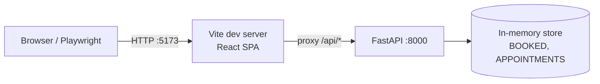
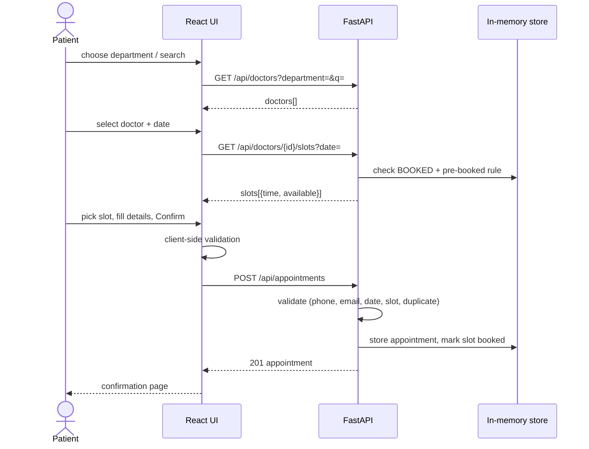

# Architecture

## 1. Overview

CityCare Hospital's online appointment portal is a two-tier web app:

| Layer    | Tech                          | Location     | Port |
|----------|-------------------------------|--------------|------|
| Frontend | React 18 + Vite 6 (SPA)       | `frontend/`  | 5173 |
| Backend  | Python 3.13, FastAPI, Pydantic | `backend/`   | 8000 |
| Storage  | In-memory Python dicts        | `backend/app/data.py` | – |

The Vite dev server proxies every `/api/*` request to the backend, so the browser only talks to
`http://localhost:5173` (no CORS issues, and Playwright needs a single base URL).



## 2. Folder structure

```
playwright-hospital-appointment-booking/
├── README.md
├── backend/
│   ├── requirements.txt
│   ├── app/
│   │   ├── main.py        # routes, request validation, bug-injection flags
│   │   └── data.py        # seed data (departments, doctors, slots) + in-memory store
│   └── doc/               # <- you are here
│       ├── architecture.md
│       ├── api.md
│       ├── business-rules.md
│       ├── testing-guide.md
│       ├── bdd-guide.md / behave-guide.md / playwright-guide.md
│       └── README.md      # index of all docs
└── frontend/
    ├── index.html
    ├── vite.config.js     # dev server + /api proxy
    └── src/
        ├── main.jsx       # React entry
        ├── App.jsx        # whole booking flow (single component, step-by-step)
        ├── api.js         # fetch wrapper for the backend
        └── styles.css
```

## 3. Backend

- **`main.py`** defines the FastAPI app, the `BookingRequest` Pydantic model (field validators for
  name and phone, `EmailStr` for email) and all routes.
- **`data.py`** holds the seed data and the two stores:
  - `BOOKED: {(doctor_id, iso_date, time) -> appointment_id}` – used for slot availability.
  - `APPOINTMENTS: {appointment_id -> appointment dict}` – used for lookups and duplicate detection.
- State lives in process memory: restarting the backend clears all bookings.
- **Bug injection:** the `BUGS` environment variable (comma separated) re-introduces the four
  defects from the brief. See `testing-guide.md`.

## 4. Frontend

`App.jsx` is a single stateful component that reveals sections progressively:

1. **Find a doctor** – department dropdown + debounced (200 ms) search box.
2. **Date & time** – appears after a doctor is chosen; slot grid refetched on doctor/date change.
3. **Patient details** – appears after a slot is chosen; client-side validation, then POST.
4. **Confirmation** – replaces the page with the appointment returned by the server.

The UI renders what the server returns on the confirmation page (it does not echo its own
state), which is why a backend defect such as the wrong doctor is visible to a user and to tests.

Double-submit protection on the client: the confirm button is disabled while a request is in
flight and the submit handler ignores re-entry. The server independently rejects duplicates.

## 5. Booking sequence



## 6. Design decisions

- **No database** – keeps setup to two commands and makes `POST /api/test/reset` trivial.
- **Deterministic slots** – a pure function of doctor, date and time marks some slots as taken, so
  test results do not depend on randomness.
- **`data-testid` on every interactive element** – stable selectors for Playwright.
- **Validation on both sides** – the UI blocks bad input for usability; the API is the real
  authority (and is what API-level Playwright tests target).
